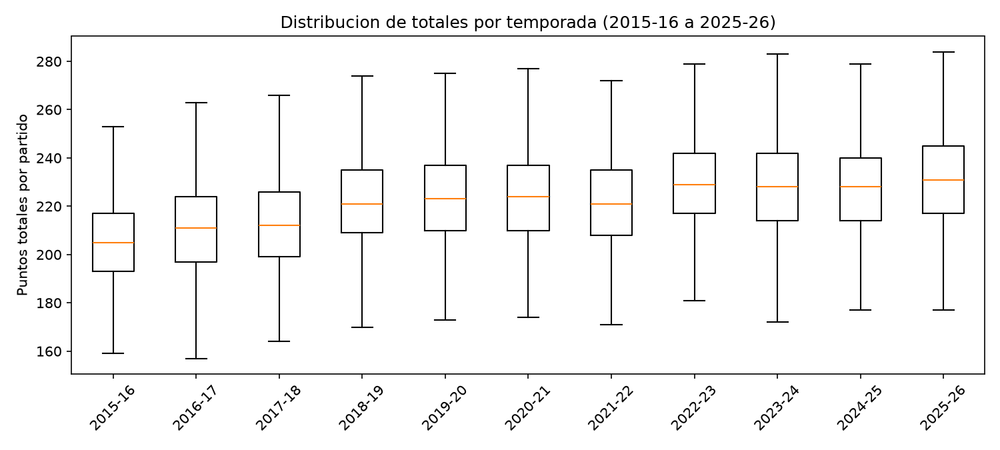
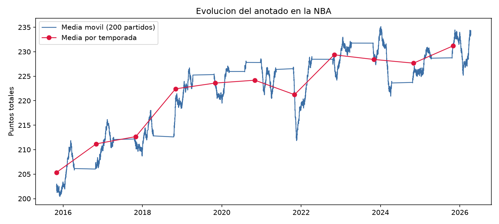
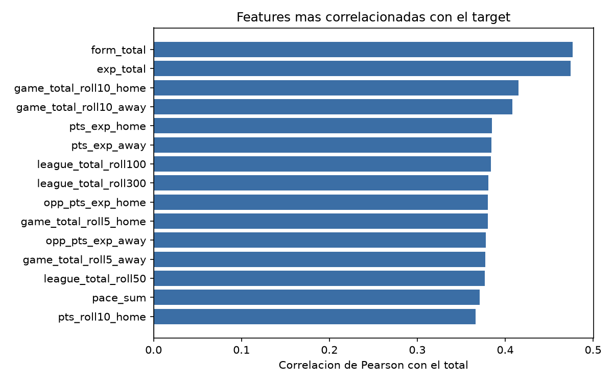

# Analisis exploratorio

- Partidos analizados: **13,199**
- Rango: **2015-10-27** a **2026-04-12**
- Media de puntos totales: **221.5** (desviacion tipica 21.5)
- Partidos con 270+ puntos: **1.6%**

## Totales por temporada

| season | partidos | media | mediana | desv_tipica | minimo | maximo | prorroga_pct | partidos_270plus_pct |
|---|---|---|---|---|---|---|---|---|
| 2015-16 | 1230 | 205.34 | 205.00 | 19.14 | 152 | 291 | 0.06 | 0.00 |
| 2016-17 | 1230 | 211.18 | 211.00 | 19.83 | 144 | 281 | 0.06 | 0.00 |
| 2017-18 | 1230 | 212.67 | 212.00 | 19.79 | 158 | 290 | 0.05 | 0.00 |
| 2018-19 | 1230 | 222.42 | 221.00 | 20.63 | 168 | 329 | 0.05 | 0.02 |
| 2019-20 | 1059 | 223.60 | 223.00 | 20.39 | 156 | 317 | 0.07 | 0.02 |
| 2020-21 | 1080 | 224.18 | 224.00 | 19.86 | 165 | 295 | 0.05 | 0.02 |
| 2021-22 | 1230 | 221.23 | 221.00 | 20.00 | 171 | 310 | 0.05 | 0.01 |
| 2022-23 | 1230 | 229.37 | 229.00 | 19.49 | 169 | 351 | 0.06 | 0.02 |
| 2023-24 | 1230 | 228.42 | 228.00 | 20.27 | 152 | 309 | 0.05 | 0.03 |
| 2024-25 | 1225 | 227.67 | 228.00 | 19.80 | 172 | 299 | 0.05 | 0.02 |
| 2025-26 | 1225 | 231.21 | 231.00 | 19.90 | 169 | 302 | 0.04 | 0.03 |

La liga anota bastante mas que en 2015-16: el nivel medio sube ~25 puntos por partido. Por eso el modelo incluye medias moviles del total de la liga en varias ventanas: sin ellas, un modelo entrenado en el pasado subestimaria sistematicamente las temporadas recientes.

## Nulos en features

| feature | pct_nulos |
|---|---|
| opp_pts_exp_home | 0.04 |
| pace_exp_home | 0.04 |
| off_rtg_exp_home | 0.04 |
| pts_exp_home | 0.04 |
| def_rtg_exp_home | 0.04 |
| off_rtg_exp_away | 0.04 |
| opp_pts_exp_away | 0.04 |
| pace_exp_away | 0.04 |
| def_rtg_exp_away | 0.04 |
| pts_exp_away | 0.04 |

Los nulos se concentran en las primeras jornadas de cada temporada (min_periods=3) y los imputa el pipeline con la mediana.

## Correlaciones con el target

| feature | correlacion |
|---|---|
| form_total | 0.48 |
| exp_total | 0.47 |
| game_total_roll10_home | 0.42 |
| game_total_roll10_away | 0.41 |
| pts_exp_home | 0.38 |
| pts_exp_away | 0.38 |
| league_total_roll100 | 0.38 |
| league_total_roll300 | 0.38 |
| opp_pts_exp_home | 0.38 |
| game_total_roll5_home | 0.38 |
| opp_pts_exp_away | 0.38 |
| game_total_roll5_away | 0.38 |
| league_total_roll50 | 0.38 |
| pace_sum | 0.37 |
| pts_roll10_home | 0.37 |

Correlaciones de ~0.4-0.5 parecen altas, pero una parte importante viene de la tendencia de epoca: la correlacion intra-temporada media es 0.32 (rango 0.24-0.41), que es la senal real que puede explotar el modelo. Ademas, correlacion no implica causalidad ni capacidad de prediccion.

